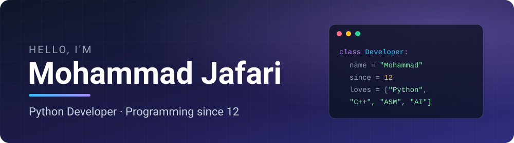
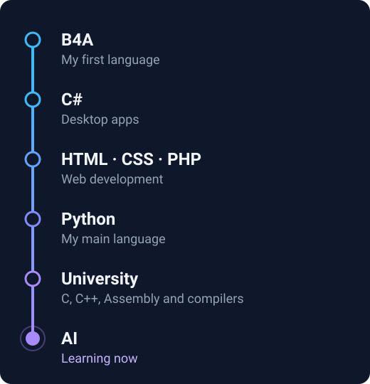

<picture>
  <source media="(prefers-color-scheme: dark)" srcset="https://readme-typing-svg.demolab.com?font=Fira+Code&weight=500&size=20&duration=3500&pause=1200&color=818CF8&center=true&vCenter=true&width=620&lines=Programming+since+I+was+12;Python+is+my+daily+driver;Currently+learning+Artificial+Intelligence">
  
</picture>

## About me

I started programming at 12-13 with B4A, then moved on to C#, web development (HTML, CSS, PHP) and Python. At university I learned C++ and Assembly, and got deep into how compilers work.

- **Python** is my daily driver. I love it because it is easy to use and you can do almost anything with it
- **Assembly** is a language I enjoy. You have to understand the hardware and its complexities to write programs for it
- I am also learning **Artificial Intelligence**. It helps a lot in programming and makes building projects easier
- I enjoy learning new skills and adding new tools to my toolbox

## Languages and tools

## My journey

## Find me

